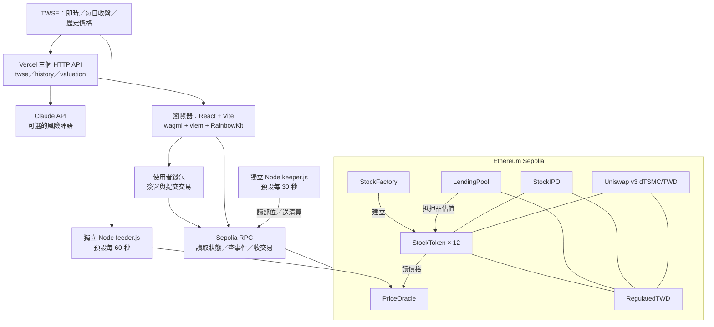
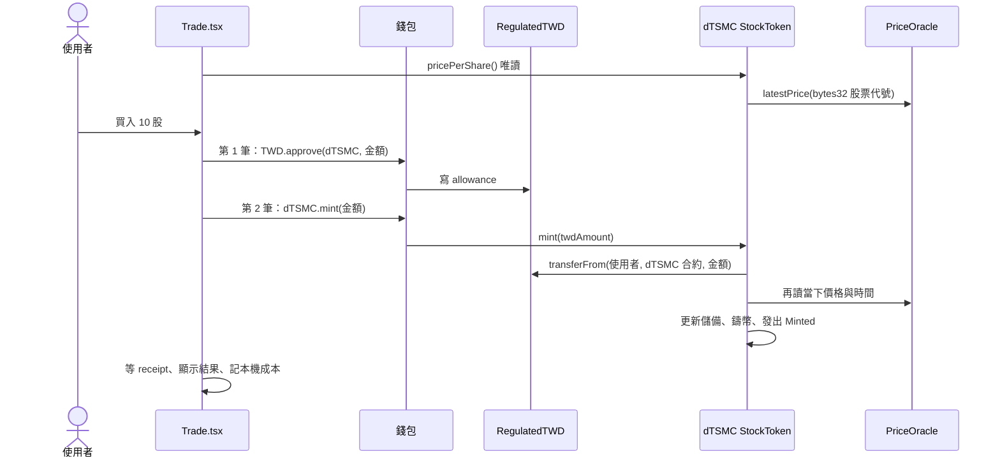

# FormosaX：架構、程式碼與兩小時教學導讀

分析日期：2026-10-09，台北時間。以本機桌面「清大rwa工作坊」的程式為準，版本為 `f2b0172`。

來源位置：`本儲存庫`。專案文件記錄的網站為 [rwa0607.vercel.app](https://rwa0607.vercel.app)，本次沒有核對線上部署是否與本機一致。

本講義包含系統架構、每個核心模組、交易與資金流、計算公式、實作限制、授課時間表與問答。另見 `02_全檔案與函式索引.md`，可定位全部自有程式、設定、教材及函式宣告。

授課安排已依你補充的 BSOS 教材更新：前 60 分鐘講區塊鏈／以太坊／智能合約，後 60 分鐘含 5 分鐘休息與專案實例。完整頁碼與講師提詞見 `03_清大兩小時課程整合版.md`，搭配 `04_BSOS基礎課精選投影片.pdf`。

## 1. 先把作品定位講清楚

FormosaX 是以台股價格為參考的 **Sepolia 測試網代幣與 DeFi 教學系統**。使用者領取測試 TWD，按自建預言機價格鑄造股票代幣，再進行贖回、AMM 交換、抵押借貸和庫存認購。

程式裡有真實的 ERC-20 合約呼叫與鏈上狀態變更；但沒有接券商下單、實股保管、銀行收付款或股東權利登記。`dTSMC` 是本專案發行的測試代幣，不能由程式推導出持有人擁有台積電股票。

建議開場說法：

> 今天用一個台股價格參考的測試網作品，拆解資產代幣、預言機、錢包交易與 DeFi 的組合方式。鏈上資產與交易流程已實作；真實股票保管、法幣儲備與法律權利仍是產品化需要補上的部分。

| 畫面／名稱 | 程式實際做的事 | 教學時的準確描述 |
|---|---|---|
| 台股代幣 | 每檔一個 ERC-20，用 TWD 按 oracle 價鑄贖 | 台股價格參考的代幣化流程示範 |
| TWD 穩定幣 | 公開水龍頭鑄造，儲備欄位同步增加 | 測試計價代幣與監管控制示範 |
| 100% 儲備 | `reserveAttestedTWD / totalSupply` | 合約內記帳比例，非銀行資金的獨立證明 |
| SpaceX IPO | 顯示品牌改名，底層 inventory 是 d0050 | 用 d0050 示範固定價認購與比例分配 |
| AI 估值 | JS 算波動風險，Claude 生一句評語 | 規則風險指標加語言模型說明 |
| 自動清算 | Node keeper 主動提交 `liquidate` 交易 | 鏈下機器人驅動鏈上清算 |
| 24/7 | 合約和 AMM 不自行限制台股盤中時段 | 可隨時提交交易；來源行情可能仍是上次交易日價格 |

## 2. 整體架構：五個執行位置



第一層是瀏覽器，顯示資料、計算風險與損益，並請錢包簽交易。第二層是 Vercel，提供 SPA 靜態檔案與三個行情／AI API。第三層是 Sepolia，保存餘額、授權、借款、認購與價格等狀態。第四層是獨立 feeder，抓行情並用自己的錢包更新 oracle。第五層是獨立 keeper，找出可清算借款人並代償。

**Vercel 不會因為網站上線就自動持續執行 feeder 或 keeper。** 兩者必須在另一個持續運行的程序裡啟動。程式目前沒有一般應用後端資料庫；持倉在鏈上，本機買賣成本在 localStorage。

### 各種資料存在哪裡

| 資料 | 儲存位置 | 誰能改 |
|---|---|---|
| TWD／股票代幣餘額、allowance | ERC-20 合約 | 持有人、獲授權合約及各發行規則 |
| 台股參考價與寫入時間 | PriceOracle | 被授權 feeder |
| 股票代幣登記 | StockFactory | factory owner |
| 借款、存款份額、抵押品 | LendingPool | 使用者操作、清算人、參數 owner |
| 認購出資、是否已領配額 | StockIPO | 使用者與發行人依函式權限操作 |
| 近月收盤 | TWSE → HTTP API → React state | 上游資料與抓取程序 |
| 買入平均成本 | 瀏覽器 localStorage | 本機 Trade 頁；不是鏈上歷史帳本 |
| 合約地址、ABI、前端股票清單 | deployed.json、catalog.ts | 專案開發／部署者 |
| Claude key | 伺服器環境變數 | 部署環境管理者 |

## 3. 建議閱讀順序

先讀 `main.tsx → App.tsx → lib/contracts.ts`，知道頁面怎麼啟動與找合約。接著讀 `Trade.tsx → useTx.ts → StockToken.sol → PriceOracle.sol`，追完一筆買入。再讀 `RegulatedTWD.sol` 理解交易中的「錢」。最後依序讀 feeder、LendingPool＋keeper、StockIPO、Swap、Portfolio 與 Risk。

這樣讀會先建立一條完整主線，再把其他功能接上去。全部函式位置可查第二份索引；以下路徑均以來源專案為根目錄。

## 4. 前端如何啟動與連到合約

### 4.1 `frontend/src/main.tsx`、`App.tsx`

`main.tsx` 建立 React root，從外到內包覆 WagmiProvider、QueryClientProvider、RainbowKitProvider 和 BrowserRouter。wagmi 提供錢包與合約 hooks；React Query 管理 wagmi 查詢快取；RainbowKit 提供連線視窗；Router 切換八個頁面。Toaster 顯示一般訊息，TxOverlay 訂閱全域交易狀態。

`App.tsx` 的 Layout 是共同外框，包含 `/`、`/portfolio`、`/trade`、`/swap`、`/lending`、`/risk`、`/ipo`、`/stablecoin` 八頁。`Layout.tsx` 做導覽、連線、餘額與領取 100,000 測試 TWD。

### 4.2 `lib/wagmi.ts`、`wallet.tsx`

wagmi 設定只列 Sepolia，chain ID 為 `11155111`，RPC 由 `VITE_RPC_URL` 或程式中的公開節點提供。WalletConnect project ID 沒設定時用佔位字串；不能把手機掃碼當成已可用功能。`wallet.tsx` 包裝錢包地址、連線狀態、連線視窗和斷線操作。

### 4.3 `lib/contracts.ts`、`deployed.json`

`contracts.ts` 從 `frontend/src/deployed.json` 匯出 TWD、ORACLE、FACTORY、LENDING、IPO 的地址與 ABI，並提供股票查找、bytes32 編碼、交易與合約瀏覽連結。

ABI 是「呼叫合約的函式說明書」，合約地址是「這份說明書對應的鏈上實例」。前端沒有把 Solidity 放進瀏覽器執行，而是透過 ABI 把函式與參數編碼後，交給 RPC／錢包。

部署腳本會同時寫 `onchain/deployed.json` 與 `frontend/src/deployed.json`。本次確認兩檔位元組完全相同。注意前端的 `STOCKS` 是部署產物中的靜態清單，不會每次自動問 factory 有沒有新增股票；管理者新增合約後仍要更新前端設定和 catalog。

## 5. 一筆買入：從點按鈕到鏈上餘額

主要入口：[Trade.tsx](本儲存庫/frontend/src/routes/Trade.tsx:47)、[useTx.ts](本儲存庫/frontend/src/hooks/useTx.ts:18)、[StockToken.sol](本儲存庫/onchain/contracts/StockToken.sol:73)。



### 5.1 先理解三種數值單位

| 數值 | 程式表示 | 範例 |
|---|---|---|
| feeder 股價 | 整數加 decimals | 1,000 元 → `100000, decimals=2` |
| TWD 金額 | 6 位小數 | 1,000 TWD → `1000000000` |
| 股票代幣 | 18 位小數 | 1 股 → `1000000000000000000` |
| bps | 萬分之一 | 5000 = 50%；10000 = 100% |
| WAD | 比例乘 1e18 | 借款指數初值 `1e18` |

區塊鏈裡用整數做金額運算，前端最後才格式化顯示。小數位是縮放規則，不是金額真的放大。

### 5.2 買入的實際步驟

假設 oracle 每股 1,000 TWD，買 10 股。前端讀 `pricePerShare()` 得到 `1000 × 10^6`，再乘股數，得到要支付的 `10000 × 10^6`。

第一筆交易呼叫 **TWD 合約**的 `approve`，spender 是 **dTSMC 合約地址**。它只建立動用額度，不會立即把錢轉走。第二筆才呼叫 **dTSMC 合約**的 `mint`。

`StockToken.mint` 檢查數量、透過 TWD 的 `transferFrom` 拉入代幣，再依最新 oracle 價計算股票代幣數量。增加 `totalTwdReserve`、鑄到使用者地址，最後發出 `Minted` 事件。

```text
pricePerShare = oraclePrice × 10^6 / 10^oracleDecimals
tokenRaw     = twdRaw × 10^18 / pricePerShare
```

合約呼叫失敗時，這筆交易裡的狀態變更整體回復。因此即使 mint 先執行 transferFrom，後面的價格檢查 revert，也不會只扣 TWD 卻沒鑄幣。

### 5.3 賣出的路徑

`redeem(tokenAmount)` 按當下價格算 TWD，檢查使用者餘額及記帳儲備是否足夠，再燒掉股票代幣、扣儲備、轉回 TWD。燒的是呼叫者自己持有的代幣，所以這條路不需要先對股票代幣 approve。

```text
twdRaw = tokenRaw × pricePerShare / 10^18
```

這裡有兩種不同的「贖回」：StockToken.redeem 會把股票代幣換成鏈上 TWD；RegulatedTWD.requestRedemption 則燒掉 TWD 並留下記錄，沒有實際銀行匯款。

### 5.4 `useTx → txStore → TxOverlay`

`useTx.run` 先把狀態改為 signing，呼叫 `writeContractAsync` 請錢包提交交易。拿到 hash 後改 pending，等待 receipt，再改 success；丟出例外時改 error。`txStore` 用 `useSyncExternalStore` 通知全域 TxOverlay，動畫不是合約運算的一部分。

成功與失敗的判斷依賴 wagmi 提交及等待 receipt 的行為。教學時可帶學生同時核對 receipt、事件與實際餘額，理解動畫只是前端狀態呈現。取得 receipt 也不等於已等到更長期的共識最終性。

### 5.5 交易頁目前的兩個限制

買入用 `BigInt(shares)`，賣出同樣先把股數轉 BigInt。輸入 `0.1` 會失敗，雖然底層 ERC-20 和 mint 公式支援小數股。借貸頁則 `Math.floor(n)`，小數抵押會被截斷。現場 Trade／Lending demo 先使用整數股。

買入讀價格後，先等 approve，再執行 mint；兩筆間若 feeder 更新價格，實際鑄出的股數可能不同於 UI 顯示。合約沒有 `minSharesOut` 或 deadline，前端還是把原本輸入股數記入本機成本，因此成本紀錄也可能偏差。

## 6. 六種現行合約，加一種舊測試合約

現行部署是 **5 個基礎實例＋12 個 StockToken 實例＝17 個本專案合約實例**。工廠本身是一種合約，每檔股票又是同一 StockToken 程式的獨立實例。Uniswap 另外使用既有協議合約與池。

### 6.1 `RegulatedTWD.sol`：平台的測試貨幣

基於 OpenZeppelin ERC20、AccessControl、Pausable，覆寫 decimals 為 6。

| 函式／狀態 | 作用 |
|---|---|
| `mintTWD(whole)` | 任何人可領整數顆 TWD；鑄幣並把記帳儲備加同額 |
| `issue(to, amount)` | admin 發行原始 6 位金額，同步增加儲備 |
| `attestReserves(amount, hash)` | attestor 覆寫儲備聲明、時間和文件 hash |
| `reserveRatioBps()` | 記帳儲備除以供給；供給為 0 時回 10000 |
| `requestRedemption(amount)` | 燒幣、減儲備、寫入 settled=true 的 Demo 記錄 |
| `setDisclosure(...)` | admin 改發行人／牌照／保管銀行／文件連結文字 |
| `setFrozen`、`pause/unpause` | compliance 凍結地址或停止代幣移動 |
| `_update` | 檢查暫停與 from/to 凍結，涵蓋轉帳、鑄幣與燒幣 |

constructor 把 admin、attestor、compliance 全授予同一地址；有角色機制，但目前不是人員實際分權。鏈上牌照與銀行名稱是 Demo 字串。公開水龍頭會自行增加「儲備」欄位，所以 100% 比例不提供獨立的法幣資產證明。

### 6.2 `PriceOracle.sol`：合約讀得到的價格表

以 bytes32 股票代號為 key，保存 `price`、`decimals`、`updatedAt`。owner 可設定 feeder；feeder 可呼叫單檔或批次更新。批次方法要求陣列長度相等、價格大於 0。`latestPrice` 回傳三個欄位，尚無價時 revert。

這是**自訂價格介面**。程式沒有實作 `latestRoundData()` 等完整 Chainlink AggregatorV3 介面；既有 QA 中「介面一致、可無痛替換」的說法不準確。替換時要有 adapter 或修改使用端，而且已部署 StockToken 的 oracle 地址是 immutable。

### 6.3 `StockFactory.sol`：共用模板量產

constructor 固定 TWD 與 oracle。owner 呼叫 `createStock`，會 new 一個 StockToken，傳入名稱、符號、貨幣、預言機、股票代號和 owner。`tokenOf` 防止同代號重複上架，`allStocks` 存清單，並發出 StockCreated。

StockToken 的 owner 是工廠設定的部署者 owner，不是 factory 合約本身。工廠目前沒有管理者移轉函式；PriceOracle 也沒有 owner 移轉函式。StockToken、LendingPool 和 StockIPO 則繼承 Ownable。

### 6.4 `StockToken.sol`：價格參考的鑄贖器

除了 mint／redeem，還有 `previewMint`、`previewRedeem`、`pricePerShare`、儲備和供給檢視，以及黑名單、KYC 標記與 pause。

`pricePerShare` 要求價格為正、鏈上寫入時間距今不超過 `maxPriceAge`；預設 30 天，owner 可改。`getReserveStatus` 同時回記帳儲備、股票供給與合約實際 TWD balance。`getCollateralRatio` 是整數百分比，100 代表 100%，不同於其他合約的 bps。

KYC 只記錄 bool，沒有當成交易條件。黑名單攔截 `_update` 的轉入／轉出，包括 mint/burn。StockToken 的 pause 只套在 mint／redeem，普通 ERC-20 transfer 沒被 pause 擋住；TWD 的 pause 則涵蓋所有 `_update`。

**關鍵經濟限制：股票漲價不會讓 TWD 儲備一起增值。**

假設只有一位使用者以 1,000 TWD 鑄出 1 股，合約儲備 1,000。oracle 漲成 1,200 後，1 股按程式應贖回 1,200，但儲備只有 1,000，會因 `insufficient reserve` 失敗。抵押率約 83%。合約沒有實股、避險資產、自動補資或外部結算收益。

反過來，跌到 800 後贖回 1 股，會留 200 TWD 儲備與 0 股票供給。沒有處理殘餘資金的完整產品規則。因此「mint 當刻等值」不能延伸成「之後永遠足額」。既有 rwa.test.js 也明確測試了漲價造成抵押率低於 100%。

### 6.5 `MockTWD.sol`

舊版公開水龍頭，沒有儲備與合規控制。仍被 `rwa.test.js` 使用；現行 deploy.js 部署的是 RegulatedTWD。它不是完全沒用，而是保留在舊核心測試裡。

## 7. 三條價格資料路徑要分開理解

### 7.1 成交定價：`feeder.js → PriceOracle → StockToken`

feeder 是鏈下 Node 程式，ethers 連 RPC，axios 抓 TWSE。讀取 stocks.js 的 12 檔，可透過 EXTRA_CODES 追加。MIS 每次最多 50 檔、上鏈每筆最多 40 檔；價格轉成兩位小數整數，呼叫 `updatePrices(..., 2)`。預設 60 秒執行一次。

選價順序實際是：成交價 `z` → 前筆價 `pz` → 買賣中間價 → 單邊買價或賣價 → 今日開盤 → 昨收。某檔沒有值才補每日收盤。它不是保證每次都餵「最新成交價」，有些值是估計或較早的價格。

oracle 的 updatedAt 是 **本次寫上鏈的時間**，沒有保存來源行情時間。重新餵昨日價格也會更新時間戳；所以它證明「剛寫入」，不證明「剛成交」。30 天保護也只是拒絕太久沒寫入的價格，不保證成交價可靠或即時。

腳本首輪 `await feedOnce()` 沒有外層 catch，初次交易失敗可能直接退出；後續 interval 才有 catch。`餵價.bat` 提供退出後重啟，但畫面的「每 10 分鐘」文字過時。setInterval 沒有忙碌鎖，慢輪次可能重疊。

### 7.2 顯示漲跌：`/api/twse → useTwse → usePrices`

`api/twse.js` 優先取 MIS，整批失敗才取 STOCK_DAY_ALL，全部失敗回空物件。若 MIS 只缺少部分股票，不會逐檔補 daily。HTTP 回覆帶共享快取指示；它不是資料庫。

`useTwse` 每 60 秒抓一次。`usePrices` 每 30 秒 multicall 讀 oracle，拿 HTTP 資料的 `close - change` 當昨收，計算鏈上價相對基準的百分比。oracle 不可用時，才用 HTTP 價、歷史末筆或原本狀態。

**畫面可能顯示後備價，但合約不會用這個畫面後備價成交。** 合約仍然讀 oracle，過期就會 revert。UI 目前沒清楚標示價格來源與新鮮度；第一畫面還會以 catalog 的固定後備價初始化。

### 7.3 走勢和風險：`/api/history → useTwseHistory`

history API 分四檔並行抓 TWSE 當月 STOCK_DAY，少於 8 筆才補前月，最多保留末 22 筆。當月有 8～21 筆時不補上月，因此不是保證完整近 22 日。只回數字陣列，沒有日期。回覆帶 12 小時共享快取指示。

`usePrices` 有至少兩筆歷史時，把收盤陣列加上鏈上價作末點；無歷史才呼叫 `series()` 畫決定性的合成波形。這不是分時 tick 圖，也可能混合歷史收盤與不同時間的鏈上末價。教學時應明說後備曲線存在。

### 7.4 本機與部署的差異

Vite dev 原本不會執行 Vercel serverless handler，因此 vite.config.ts 加 middleware，重用三個 API 的純 JS 函式。Vercel 的 vercel.json 則把非 `/api/` 路徑 rewrite 到 index.html，讓直接打開 `/trade` 也能載入 SPA。

## 8. 借貸：把代幣變成可抵押部位

主要入口：[LendingPool.sol](本儲存庫/onchain/contracts/LendingPool.sol:118)、[Lending.tsx](本儲存庫/frontend/src/routes/Lending.tsx:100)。

### 8.1 出借方：TWD 換成帳上份額

先 approve LendingPool，再 depositTWD。存款份額是 mapping 記帳，不是可轉讓 ERC-20 receipt token。

```text
exchangeRateWad = (cash + totalBorrows) × 1e18 / totalDepositShares
新份額           = amount × 1e18 / exchangeRateWad
用戶存款價值      = userShares × exchangeRateWad / 1e18
```

沒有份額時匯率從 1e18 開始。借款利息增加 totalBorrows，進而增加每份價值。withdrawTWD 銷毀對應份額，採向上取整，且 cash 必須足夠；帳面存款價值大，不代表池子當下都有可提現 TWD。

### 8.2 借款方：股票抵押換 TWD

owner 先 addCollateral 登記抵押品。使用者 approve 股票代幣給 LendingPool，再 supplyCollateral；之後 borrowTWD 把池內現金轉給借款人。

抵押價值由各 StockToken 的 `previewRedeem` 取得，使用 oracle 估值，**沒有檢查該股票代幣合約實際能否足額贖回**。所有抵押品共用同一組全域風險參數。

```text
可借總額 = 抵押價值 × 50%
尚可借額 = max(可借總額 − 目前債務, 0)
HF       = 抵押價值 × 65% / 債務
```

範例：10 股、每股 1,000，抵押 10,000 TWD，最多借 5,000。借 4,000 時 HF = 1.625；跌到每股 500，HF = 5000 × 65% / 4000 = 0.8125，可清算。

`withdrawCollateral` 只要求取回後 HF ≥ 1，不是重新限制債務一定低於 50% LTV，所以有借款時取回抵押後可落在 50%～65% 之間。`repay` 只還呼叫者自己的債，金額多於債務會截到實際債務。

### 8.3 利息：使用率與借款指數

```text
使用率 U = totalBorrows / (cash + totalBorrows)
借款 APR = 2% + 20% × U
出借 APR ≈ 借款 APR × U
期間利率 = 借款 APR × 經過秒數 / 一年秒數
借款指數 = 舊指數 × (1 + 期間利率)
個人債務 = 本金快照 × 現指數 / 快照指數
```

`accrue()` 由鏈上交易觸發，是按呼叫間隔累積的簡化模型，合約不會在背景每秒自行寫狀態。存、取、借、還、清算等會先呼叫 accrue。唯讀 `debtOf/getUserAccount/getPoolStats` 不會補算自上次 accrue 以來的利息，畫面的債務與利率統計可能落後。

目前沒有從利息抽取平台 reserve factor，不能把簡報中的「借貸利差營收」當成已實作收費。

### 8.4 清算與 keeper

`liquidate` 先 accrue，檢查 HF < 1。清算人拿自己的 TWD 代還債務，獲得按 oracle 折算、額外 5% 的抵押品。

```text
沒收價值 = 代償 TWD × 1.05
沒收股數 = 選定抵押股數 × 沒收價值 / 該抵押品估值
```

超過選定抵押數量時只把 seize 封頂，沒有同步降低 pay；因此清算人可能付超出這批抵押品對應價值的 TWD。系統也沒有完整壞帳分攤設計。

keeper 每 30 秒掃帳，啟動時從近期 120,000 區塊的 Borrow 事件收集借款人，每 10 輪重掃。HF < 1 時選第一個有餘額的抵押 token，以 min(債務、keeper TWD 餘額) 代償。它沒有利潤檢查或按單一抵押價值限制代償，也可能漏掉掃描範圍外或 RPC 查詢失敗區段的借款人。

keeper 本身不先呼叫 accrue；僅靠利息累積使部位變得危險時，讀到的舊 index 可能尚未反映。它的「自動」是程式主動發交易，仍需要運行中的程序、TWD、ETH、可用 RPC 與可轉讓抵押品。

## 9. IPO：固定價庫存分配，不是交易頁的 mint

主要入口：[StockIPO.sol](本儲存庫/onchain/contracts/StockIPO.sol:49)、[IPO.tsx](本儲存庫/frontend/src/routes/IPO.tsx:14)。

發行人先持有股票代幣，approve StockIPO，再 createOffering 把庫存轉進合約。使用者在窗口內 approve TWD 並 subscribe。結束後 finalize，claim 轉出預存代幣與退款；claim 不會新鑄股票。

不足／剛好滿額時，股數為「自己的出資 ÷ 認購價」；超額時按出資占比分庫存。

```text
超額配發股數 = totalShares × userPaid / totalRaised
實際成本     = 配發股數 × 固定價
退款         = userPaid − 實際成本
```

例：100 股，每股 800，最多募 80,000。Alice 出 40,000、Bob 出 120,000，合計 160,000。Alice 得 25 股退 20,000；Bob 得 75 股退 60,000。這是比例配額，沒有亂數抽籤。

部署腳本實際選 d0050、以部署時 oracle 價打九折、存約 200 股、開 7 天窗口。前端把 0050 對應為 SpaceX/dSPACEX，另顯示硬編碼 US$135、固定匯率 32.5；認購仍收 TWD，合約用自己的 priceTWD，顯示的美元價沒有決定實際配額。

### 需要知道的合約缺陷

`ownerReclaimUnsold` 把 `totalShares − sharesSold` 都當可回收庫存，但 sharesSold 只在已 claim 時增加；尚未領取的配額也會被視為 unsold。函式還會修改 totalShares，而後續 `_entitlement` 又用它重新計算配額。

以上範例中 Alice 領完 25 股，owner 若回收「未售」75 股，totalShares 變 25，Bob 的配額會從 75 變成 18.75 股。這是靜態程式可推導的分配錯誤，既有測試沒有涵蓋此路徑。課堂可以講解原本的比例分配，但不應把發行人回收機制當成已驗證正確。

## 10. Uniswap：同一代幣的另一條交易路徑

Trade 跟 StockToken 鑄贖；Swap 跟 Uniswap 流動池交換既有代幣。Swap 不會經由 StockToken mint/redeem，也不以 oracle 強制定價。

| 比較 | Trade | Swap |
|---|---|---|
| 對手／標的合約 | 每檔 StockToken | Uniswap Router 與池 |
| 價格 | oracle | 池內價格、交換數量、流動性 |
| 代幣供給 | mint 增加、redeem 減少 | 換手，不改股票總供給 |
| 授權對象 | 買入授權 StockToken | 授權 Router |
| 主要限制 | 價格過期、儲備不足 | 流動性、滑價與最低輸出 |

`uniswap_pool.js` 備好 200 股 dTSMC 與等值 TWD，以地址排序 token0/token1，按 oracle 價初始化 sqrtPriceX96，透過 NonfungiblePositionManager 建池並加入全幅流動性，最後把 uniswap 設定寫回兩份 deployed.json。

`Swap.tsx` 透過 QuoterV2 以 eth_call 估價，輸入停止 350ms 後執行。使用者 approve Router 後，呼叫 `exactInputSingle`。最低輸出實際寫成報價的 90%，也就是容許約 10% 的報價偏移；程式註解寫 5～10%，但數字固定為 10%。

`usePoolPrice` 從 slot0 的 sqrtPriceX96 平方，轉成 token1_raw/token0_raw，再依 token 順序與 18／6 小數位換成 TWD/股。這是即時池內報價，不等於特定大額交易可成交的均價。

oracle 價與 AMM 價可以分歧；keeper 只負責清算，沒有套利再平衡功能。所謂套利收斂也取決於兩邊交易能執行、StockToken 有足夠儲備與行情可信。

## 11. Portfolio、Dashboard 與 AI

### 11.1 資產彙總：`useHoldings`

讀錢包 TWD、12 檔股票 balance、借貸抵押價值、存款與債務，算：

```text
netWorth = 錢包 TWD + 錢包股票市值 + 出借存款 + 質押價值 − 債務
```

股票抵押轉出錢包後由 collateral 欄計入，避免這部分重複。尚未 claim 的 IPO 權益、認購鎖定款與 Uniswap LP NFT 並沒有納入，因此不是「所有鏈上資產」完整資產負債表。

`Portfolio.tsx` 自繪 SVG donut。圖形按正資產總和分配，但旁邊百分比除以扣債後 netWorth，有債時百分比加總可能超過 100%；這是顯示口徑差異。

### 11.2 成本與事件

`costBasis.ts` 在 localStorage 依錢包地址記錄平均成本，買入累加成本、賣出按平均成本扣除。只有這個瀏覽器的 Trade 操作會記，外部轉帳、Swap、IPO、其他裝置操作不會完整反映。損益可以拿來示範平均成本法，不能當成可稽核的全鏈損益。

`useActivity.ts` 查近 90,000 區塊的 mint、redeem、borrow、repay、deposit、withdraw、supply 七類事件，依區塊排序，失敗導向 Etherscan。沒有完整索引 Swap、IPO、TWD 水龍頭、取回抵押或清算，也不會在每筆交易後自動重新掃描所有事件。

### 11.3 Dashboard 的總額口徑

`useProtocolStats` 真讀 TWD 供給、儲備率、借貸池 cash+borrows、IPO 開案數和股票供給，再計算 `TWD totalSupply + 股票市值`。讀值來自鏈上，但股票背後持有的 TWD 已在 totalSupply 內，再加股票市值會重複計入底層資產。這是毛額展示，不能直接叫淨資產或真實外部 AUM。

### 11.4 `risk.ts`：可重現的規則公式

歷史收盤至少 5 筆才計算。先算簡單日報酬，取樣本標準差乘 √252，得到年化波動。近月動能為末價／首價−1，但**風險分數本身只由波動率決定**。

```text
r_i          = close_i / close_(i−1) − 1
annualVol    = sampleStd(r) × √252
t            = clamp((annualVol − 0.12) / (0.60 − 0.12), 0, 1)
riskScore    = round(100 × t)
suggestedLTV = round(6500 − 3500 × t) bps
```

波動 ≤12% 對應分數 0、建議 LTV 65%；波動 ≥60% 對應分數 100、建議 LTV 30%。34、67 是低／中／高分類分界。這些是程式設定的規則，不是訓練模型、違約機率或預測公允價。

### 11.5 `Risk.tsx → api/valuation.js`：語言模型做說明

Risk 頁把計算後的指標 POST 給 serverless，伺服器使用 `ANTHROPIC_API_KEY`，呼叫程式設定的 `claude-haiku-4-5`，要求每檔一句繁體中文評語與 JSON。未設 key、上游失敗或解析失敗就回空，量化卡片仍可顯示。

沒有 Python 財務模型、T+1 預測、財報因子、公允價回歸或 AI 輸出上鏈。建議 LTV 只顯示，沒有自動呼叫 `LendingPool.setRiskParams`。即使手動接上，現行 setRiskParams 也只支援全域參數，不能直接套每檔不同的 LTV。

API 接收前端送來的數值，沒有在伺服器自行重新計算或驗證；回覆上的一小時 Cache-Control 指示，也不等於程式有明確的 POST 結果快取。這些都是正式化時需要另行設計的後端責任。

## 12. 部署與維運程式

`onchain` 與 `frontend` 各有 package.json，分別安裝依賴，沒有根 workspace orchestration。Hardhat 編譯 Solidity 0.8.24、OpenZeppelin 元件；前端是 React 19、Vite、TypeScript、Tailwind，錢包介面由 wagmi/viem/RainbowKit 組成。

`deploy.js` 的順序：RegulatedTWD → PriceOracle → StockFactory → LendingPool → StockIPO；抓每日收盤或固定後備價並上鏈；工廠建立 12 檔；全部登記為抵押品；領 500 萬測試 TWD、存 100 萬到借貸池；鑄 d0050 庫存並開七天 IPO；輸出地址和 ABI。

`verify.js` 向 Etherscan 提交地址與建構參數供原始碼驗證。原始碼驗證是 bytecode／編譯來源的對應，不是第三方安全審計。

`uniswap_pool.js` 是 Hardhat 腳本，應以 `npx hardhat run scripts/uniswap_pool.js --network sepolia` 選網路。部分舊文件寫直接 `node scripts/uniswap_pool.js`，會缺少明確網路選擇，不宜照抄。deploy.js 的輸出 chainId／explorer 還寫死 Sepolia；若移植網路，不能只改 Hardhat network。

現行沒有 proxy。StockToken 的 TWD／oracle 是 immutable，修改對應依賴通常要部署新合約並更新前端；不是改一個 API URL 就能替換全部鏈上地址。重新部署會產生新資產實例，不會自動遷移舊餘額或舊借貸部位。

### 本機與課前準備的已知狀態

檢查時 `frontend/node_modules`、`onchain/node_modules`、`onchain/.env`、`frontend/.env` 均不存在。前端有公開地址與 ABI，安裝依賴後可嘗試讀鏈；餵價／keeper 還需要授權錢包設定。這次沒有讀取任何私鑰，也沒有部署、餵價或發出鏈上交易。

既有 onchain 測試共 16 個：rwa.test.js 9 個、v2.test.js 7 個。覆蓋核心鑄贖、權限、儲備記帳、借貸／清算與超額認購，未涵蓋上面所有缺陷。此次未安裝依賴，故未重跑 Hardhat 或前端 build；舊文件的「16 項全綠」不能當成本次驗證結果。

## 13. 舊文件與程式衝突：講課以這張表校正

| 舊說法 | 當前程式證據／修正 |
|---|---|
| 鏈上 1:1 實股擔保 | 無券商／股票保管整合，只收 TWD 代幣 |
| 法幣 100% 儲備可由鏈上證明 | 儲備為可變記帳，公開 mint 自增欄位；無銀行資產驗證 |
| 符合完整 Chainlink AggregatorV3 | 自訂 latestPrice 三欄位，無 latestRoundData |
| Python 回歸、公允價預測已完成 | Python 只有簡報產生器；風險是 JS 規則，Claude 生成評語 |
| AI 自動動態 LTV | 沒有風險到 setRiskParams 的寫入連線；合約是全域固定參數 |
| Trade 可買 0.01 股 | BigInt(shares) 讓小數輸入失敗；合約層有小數能力 |
| SpaceX 135 美元認購 | 顯示硬編碼；合約庫存是 d0050，實際配額用鏈上 TWD 價 |
| feeder 每十分鐘／全市場 | 預設每 60 秒，12 檔加 EXTRA_CODES；FEED_LIMIT 未被讀取 |
| KYC 會阻擋未驗證帳戶 | 目前只是 bool 註記 |
| pause 全面停止股票轉帳 | StockToken 只停 mint/redeem；TWD 才在 `_update` 全面限制 |
| 停餵也能放心交易 30 天 | 只是允許 30 天內寫入價，舊價仍可能有嚴重偏差 |
| Portfolio 是所有操作與資產 | 缺 LP／IPO 等部位；事件種類與掃描區間有限 |
| keeper 自動做價格套利 | keeper 只有借貸清算 |
| 規模／儲備數字全讀鏈，所以財務口徑正確 | 鏈上來源和經濟意義不同；仍有重複計價與模擬儲備 |

既有文件對 Chainlink 服務停用時間、現行台灣法規或市場規模的外部敘述，本次沒有重新查證。此講義只根據程式說明已用與未用的技術，不用那些敘述作為課堂事實依據。

## 14. 兩小時授課順序（120 分鐘）

已依你提供的 BSOS 簡報改為「前一小時基礎、後一小時專案」。暫以大學生混合背景為基準；兩小時重點是讓學生追得完一條交易，其他模組看得懂如何接上，全部檔案細節作為課後導讀。詳細原頁／精選頁對照與講師提詞，以 `03_清大兩小時課程整合版.md` 為準。

| 時間 | 主題 | 展示／活動 | 學生應帶走的觀念 |
|---|---|---|---|
| 00–15 | 共同帳本、錢包與交易 | BSOS 精選 1–8 頁 | 寫入權、地址、to／value／data 與 gas |
| 15–37 | Ethereum、EVM、合約與 ERC-20 | BSOS 精選 9–18 頁 | 狀態、讀寫、介面、函式與事件 |
| 37–60 | 授權、買賣、原子性與組合 | BSOS 精選 19–27 頁 | approve 不扣款；transferFrom 代扣；儲備問題 |
| 60–65 | 休息 | 5 分鐘 | — |
| 65–73 | 作品定位與系統架構 | 第 1–2 節 | 瀏覽器、API、鏈、feeder、keeper 的分工 |
| 73–90 | 一筆買入完整追碼 | 第 4–6 節；Trade → useTx → StockToken | 錢包簽署、兩筆交易、原子性與餘額 |
| 90–102 | 預言機、借貸與清算 | 第 7–8 節；10 股、借 4000 的 HF 題 | 三條價格路徑、LTV／清算門檻、keeper |
| 102–110 | AMM、IPO 與 AI | 第 9–11 節；每項只講關鍵差異 | 池價／鑄贖價、庫存配發、建議與鏈上參數 |
| 110–120 | 儲備限制與 QA | 贖回儲備不足反例、第 13、15 節 | 技術能執行與經濟能成立要各自驗證 |

### 三個不用連線也能做的課堂題

1. **授權題**：用 TWD 買 dTSMC 時，approve 應呼叫哪個合約、spender 填誰？答案：呼叫 TWD，spender 是 dTSMC 合約；買入不是把 ETH 授權給平台。
2. **清算題**：10 股抵押、借 4,000、清算線 65%，忽略利息，股價跌到多少 HF=1？答案：`4000 / (10 × 0.65) ≈ 615.38`；再低於此價可清算。
3. **儲備題**：1,000 買入 1 股，漲到 1,200，要所有人都能贖回，少的 200 從哪來？現行程式沒有提供這個來源；可討論實股保管、避險、超額抵押或其他完整結算設計，而不是只把 oracle 寫得更即時。

### 建議現場示範動線

先讀價格與 timestamp，確認有近期有效 oracle 價，再連測試錢包。領 TWD → Trade 買整數 1 股（兩筆交易）→ Etherscan 看 Minted 和資產移動 → Portfolio 看餘額／本機成本 → Lending 質押並借小額 → Risk 說明建議 LTV 沒自動上鏈 → 小額 Swap 比較池價。

IPO 窗口由部署時設定且不會自動延長，當天可能已結束；以公式或已存在配額示範，不把認購成功作為全課必要條件。TWD 贖回只示範燒幣記錄，不說成真實提款。保留不依賴現場連線的架構圖與數字題，便於 RPC 或上游行情不可用時繼續講解。

## 15. 上台常見問答：可直接使用的回答

**這是真的台積電股票嗎？**

這份程式發行的是參考台股報價的測試代幣。要讓代幣對應真實股票權利，還需要券商／保管／權利與結算安排，這部分沒有寫在目前系統裡。

**為什麼一定要區塊鏈？**

這個案例主要展示同一 ERC-20 可以被不同合約持有和使用：交易、抵押、認購與 AMM 共用同一資產。一般資料庫也能做報價網站，但跨合約組合和公開狀態驗證是這份作品的教學重點。

**預言機是去中心化的嗎？**

目前不是。它是授權 feeder 寫入自建價格合約，使用者可以查寫入內容與時間，但仍需要信任行情取得與餵價者。

**有 100% 儲備欄位，能證明銀行有錢嗎？**

不能只靠這個欄位證明。程式能證明誰在鏈上聲明多少儲備；要驗證鏈下資產，需要獨立的保管、簽證與對帳機制。

**智能合約會自己清算嗎？**

合約定義清算條件，外部帳戶呼叫它才會執行。這份作品另寫 keeper 來輪詢並發交易，所以自動化仍需要鏈下程序運行。

**AI 決定借款額度嗎？**

目前沒有。JS 算風險與建議 LTV，Claude 把指標轉成評語；借貸合約仍用 owner 設定的固定全域參數。

**買入跳兩次錢包視窗，是壞掉嗎？**

這份流程先用一筆交易授權 StockToken 動用 TWD，再用一筆交易執行鑄造；兩次都是鏈上交易，需要測試 ETH 支付 gas。合約沒有額外 mint 手續費，不等於沒有網路 gas。

**有 OpenZeppelin、測試與 Etherscan verified，就代表安全嗎？**

這些分別提供標準元件、特定情境驗證和原始碼對應。經濟儲備、權限、邊界案例及外部依賴仍需要另外評估，本次已找到儲備與 IPO 分配的具體問題。

## 16. 本次分析與驗證的範圍

盤點 79 個自有程式／HTML／SVG 文字檔，共 7,254 行，包含註解與空白、以移除檔尾空白後計。應用程式、合約、維運腳本、測試、UI 與簡報產生程式已逐檔導讀；79 的數字也包括 SVG 素材，不代表 79 個業務模組。

完成 13 個 JS 檔的 `node --check`、5 個風險公式邊界斷言、兩份 deployed.json 完全一致檢查、12 檔股票和 chain ID 檢查，以及 16 個既有合約測試的靜態盤點。這些通過不等於 Solidity 部署或網站端到端操作已驗證。

未執行 Hardhat 測試、TypeScript build、真實錢包交易、鏈上現況查詢或 Vercel 部署比對；也沒有逐行審查第三方依賴與逐頁檢視舊 PDF／PPTX。IPO 回收配額等缺陷為本機程式的靜態推導，尚未在 EVM 重現。原專案程式沒有修改。
