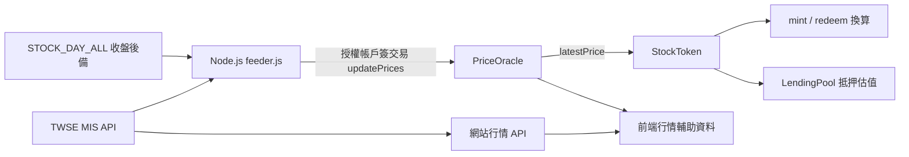

# 預言機與整個平台：快速重新理解

## 現在用的不是 Chainlink

目前程式採 **TWSE 公開行情 API + 自己運行的 Node.js feeder + 自製 PriceOracle 合約**。LINK 是 Chainlink 生態的代幣；這份 feeder 沒有使用 LINK，送寫入交易付的是 Sepolia ETH gas。

feeder 是跑在鏈外的程式，會 HTTP 抓資料；Oracle 是跑在鏈上的合約，只保存資料與檢查誰可以寫。合約本身不能直接呼叫 TWSE HTTP API。

## 你記得的「批次」有三種

| 批次位置 | 程式 | 實際做法 |
|---|---|---|
| 抓行情 | feeder.js `MIS_CHUNK=50` | 每個HTTP請求最多組50檔股票代號 |
| 寫Oracle | feeder.js `TX_CHUNK=40` | 每40檔呼叫一次 updatePrices，一批一筆交易 |
| 建股票代幣 | deploy.js 的for迴圈 | 每檔單獨createStock並等待交易，不是一筆建立全部 |

目前精選12檔，所以正常是一批抓12檔、一筆寫入12檔價格。feeder 預設每60秒排程一次；耗時太長時舊版setInterval可能重疊，不是精確保證每60秒完成。

取價順位：MIS成交價z → 前筆pz → 買賣中間價 → 單邊報價 → 開盤價 → 昨收；仍無資料才用 STOCK_DAY_ALL。這些都被程式歸在MIS或收盤來源，**不是每個值都代表剛發生的成交價**。目前沒有把來源時間寫入鏈上。

## 一股到底怎麼生出來？

假設 Oracle 每股價格1000 TWD：

1. 你先在TWD合約approve StockToken，額度1000；此時沒有扣款。
2. 呼叫StockToken.mint，付款1000 TWD。
3. StockToken透過transferFrom收款，再讀Oracle價格。
4. 1000 ÷ 1000 = 1股，合約給你1個股票代幣、記帳儲備增加1000。
5. 前端等成功收據，再查你有多少股票與TWD。

TWD有6位小數，股票代幣有18位小數。原始整數公式是：`股票最小單位 = TWD最小單位 × 10^18 ÷ 每股價格的TWD最小單位`。

贖回方向相反：看股數、算應付TWD、確認儲備、燒股票代幣、轉TWD給你。價格漲了只會改變應付金額，不會自動增加儲備。

## 為什麼畫面有價格，交易卻失敗？

完整前端 `usePrices()` 優先顯示Oracle原始價格，取不到再用API／歷史／fallback；它現在沒有按照updatedAt過濾過期值。真正mint/redeem會走StockToken.pricePerShare()，這裡才檢查30天有效期限。因此能顯示數字不代表能交易。

`updatedAt` 是最後上鏈寫入時間。即使來源是一筆舊的昨收，只要今天再寫入，updatedAt就變今天。要驗證市場資料新鮮度，必須另看來源日期，而不能只看寫入時間。

## 和 Chainlink 的差別

目前信任的是你授權的feeder帳戶與它取得的資料，沒有多個獨立節點聚合。這不是 Chainlink Data Feed 的實作，也不能直接替換地址就完成整合：目前介面是 `latestPrice(bytes32)`，Chainlink 常用的是 `latestRoundData()`、`decimals()`。需要轉接並檢查標的、單位、時間與鏈別；既有StockToken的oracle地址還是immutable。

官方對照：[Chainlink Data Feeds API](https://docs.chain.link/data-feeds/api-reference)。本庫程式：[feeder.js](../onchain/scripts/feeder.js)、[PriceOracle.sol](../onchain/contracts/PriceOracle.sol)、[StockToken.sol](../onchain/contracts/StockToken.sol)。

## 可以直接對學生說的30秒版本

「我們這份作品沒有接Chainlink，而是自己寫一個餵價程式。它從證交所API批次取得價格，再用有權限的帳戶把價格寫進鏈上的Oracle。台股代幣合約讀這個價格，計算你付多少TWD能鑄造多少股，或贖回時該拿多少TWD。Oracle負責報價，儲備負責付款；價格正確，不代表資金一定足夠。」
